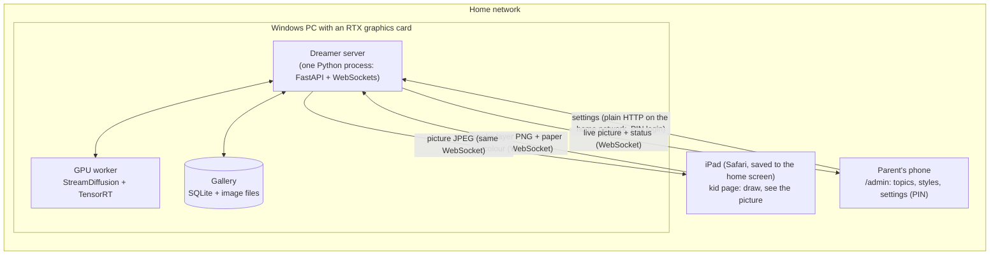
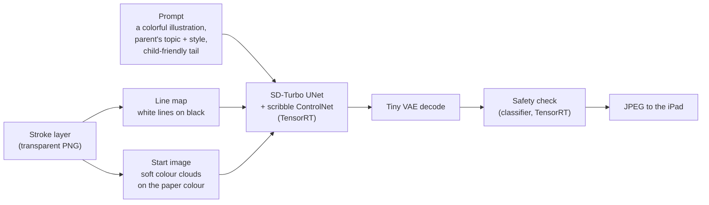
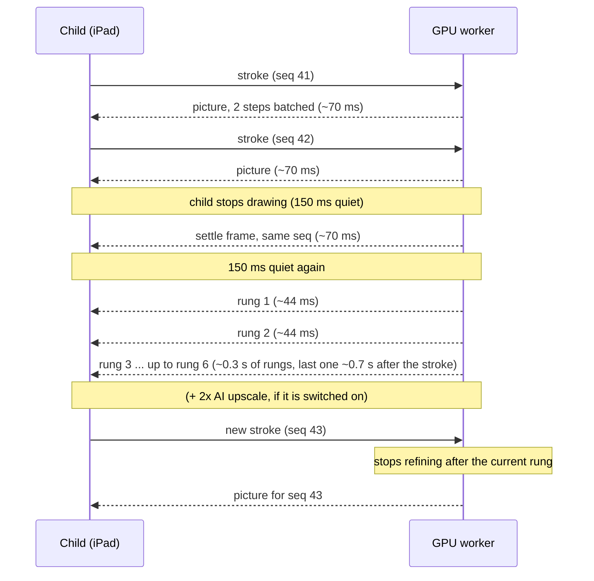

# Dreamer: how it works (for slides)

## The big picture

Drawings and pictures never leave your home network. Models are downloaded once, on the first start;
after that Dreamer runs without contacting the internet, unless the picture model is changed in
`config.yaml` (then the next start may download again, `server/offline.py`).

## From a drawing to a picture

- **Line map:** where the child drew, as white lines on black. The ControlNet makes the picture
  follow those shapes (strength 0.55: shapes yes, traced pen strokes no).
- **Start image:** instead of the sketch itself, img2img starts from blurred clouds of the
  colours the child used, on the chosen paper colour. Black paper gives night scenes.
- **Prompt:** built only on the PC from parent-approved topics and styles. The child never types.

## Draw fast, then refine

- **While drawing:** the steps run together as one batch through the UNet (StreamDiffusion's
  "denoising batch"), so the picture keeps up with the stroke. That mode returns each picture
  one frame late, so the worker re-runs the last sketch once the child pauses ("settle").
- **When the child stops:** the default "anchored" refinement model runs up to 6 single-step
  rungs at batch 1 (no extra graphics memory), about 44 ms each, each replacing the picture on
  screen. Every rung starts from less noise than the one before and its broad layout is pinned
  to the first picture, so the picture keeps its shapes and only gains detail
  ([refinement results](../research/refinement-models.md#results-2026-10-25-night-rtx-3080)).
  With AI upscale on (off by default), refined pictures go through Real-ESRGAN compact (31 ms)
  to 1280×896.
- *Superseded:* the first version continued SD-Turbo's own path in passes of 4, 8, 12, 16 and
  20 steps (153-681 ms per pass, done about 4 s after the stroke, `docs/gpu-results.md`). Past
  about 6 steps that repainted the scene, which led to the anchored model.

## Graphics memory and speed (RTX 3080, 10 GB)

| | value |
|---|---|
| Engines for up to 4 steps at once (default), 640×448 | 7.4 GB + desktop (~0.8 GB) |
| Engines for 1 step | 5.1 GB + desktop |
| Resolution 512 → 1024 px | +0.4 GB, but 56 → 186 ms per picture (2 steps) |
| AI upscaler | +0.23 GB, 31 ms |

The admin page estimates memory from a measured table (`static/vram.json`) and disables
settings that would not fit in 10 GB.

## Things we learned building it (good "behind the scenes" slide)

1. **The model ignored the drawing**: the fork's engine cache stored the UNet under the same
   name with and without ControlNet. An all-black control image gave identical pictures. Fix:
   separate engine folders.
2. **Pictures one frame late**: the batched pipeline returns the previous frame's picture, so
   the final picture never matched. Fix: prime and settle the pipeline.
3. **The pen strokes showed in the picture**: img2img started from the sketch. Fix: start from
   colour clouds, lower the ControlNet strength, neutral prompt.
4. **Flicker in step-by-step mode**: fresh random noise every frame. Fix: re-seed per frame.
5. **A ControlNet engine that cannot be built** (batch range 1-3 on TensorRT 10.12), which led
   to a CUDA crash later. Fix: only allow batch sizes that build, and stop with a clear message.
