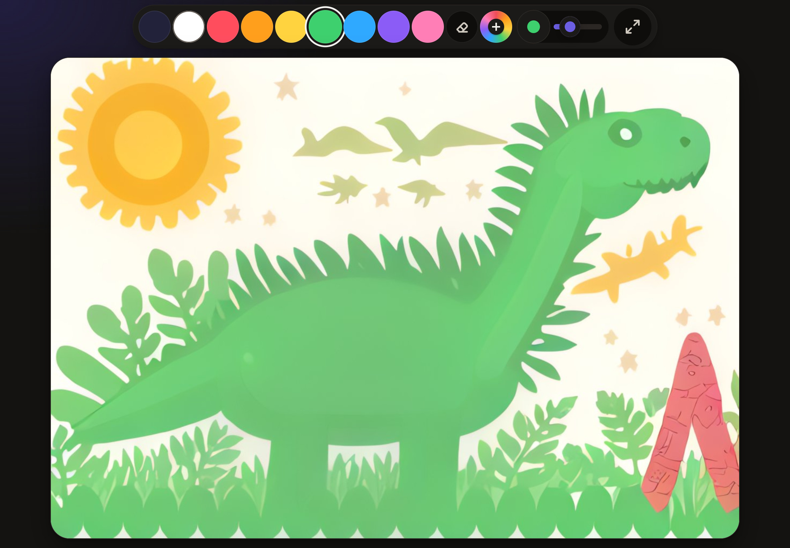
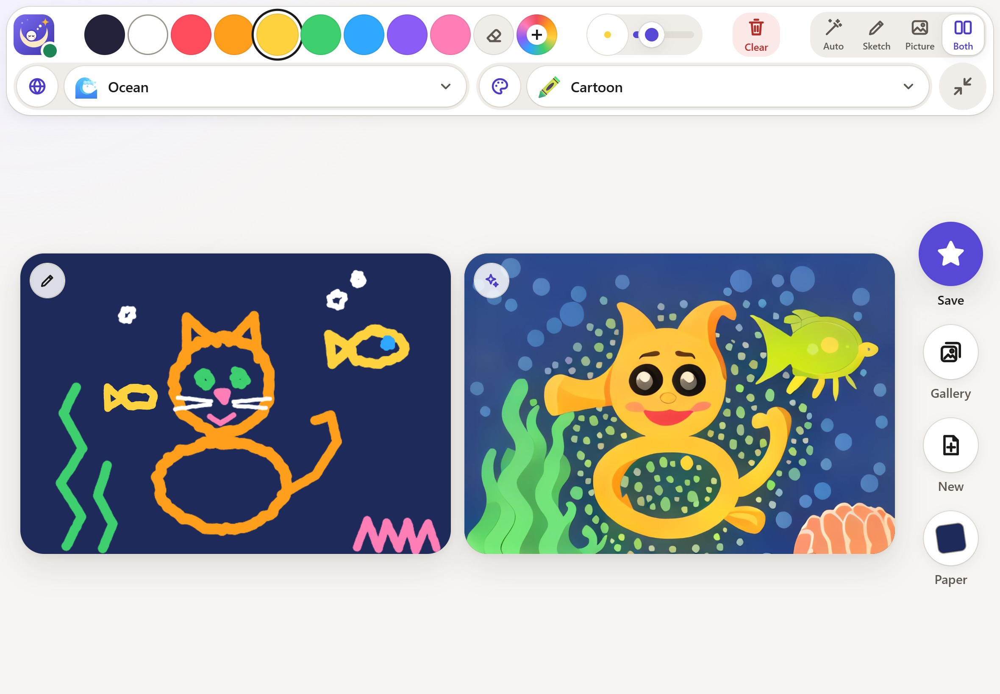
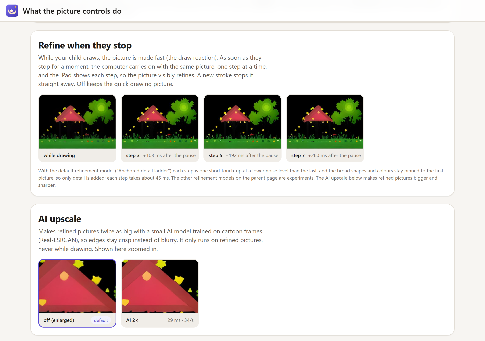

# Captions for the 12 best screenshots

For slides, social posts and the product page. Each has a short line (fits under a slide
image or in a post) and a longer caption (alt text, a post body or speaker notes). Paths
are relative to the repo root; the descriptions match what is in each image. Safety
wording: say a classifier "checks every picture", never "guaranteed". All refined pictures
in these shots were made with AI upscale on (2x); the app's default is off.

### 1. `screenshots/ipad-landscape-cat-split.jpg`

- **Short:** A cat drawn with a finger, and the picture Dreamer made of it.
- **Long:** On the left, a child's drawing of a cat with a fish, seaweed and bubbles, on
  night blue paper. On the right, the same scene as a cartoon picture under the sea: the
  cat keeps its ears, face and round body, the fish becomes a fish friend, the zigzags become
  seaweed. Ocean world, cartoon style.

### 2. `screenshots/ipad-landscape-rocket-live-split.png`

- **Short:** The picture keeps up while your child draws.
- **Long:** A rocket drawn in white, red and yellow on black paper, with a watercolor
  rocket among stars next to it. While the child draws, the picture follows within a
  fraction of a second, so the drawing and the picture grow together.

### 3. `screenshots/ipad-landscape-house-saving.jpg`

- **Short:** One tap on the star, and it's in the gallery.
- **Long:** The yellow star saves the picture together with the drawing it came from. The
  picture, a storybook house with a glowing sun and a tree, flies into the Gallery button
  and the star says "Saved!".

### 4. `screenshots/ipad-landscape-gallery.jpg`

- **Short:** "My pictures": everything your child made, in one place.
- **Long:** The gallery shows every saved picture in a big grid with its name: a flower
  meadow, a fairy-tale castle, a dino friend, a space rocket, a swimming cat and a sunny
  house. Children can look and keep drawing, but cannot delete.

### 5. `screenshots/ipad-landscape-gallery-detail.png`

- **Short:** Every picture remembers the drawing it came from.
- **Long:** Tap a saved picture to see it next to the drawing it came from, then "Keep
  drawing" to put the drawing back on the canvas and carry on. Saving again updates the
  same picture.

### 6. `screenshots/ipad-landscape-paper-picker.png`

- **Short:** A new drawing starts with a paper colour.
- **Long:** "Pick your paper": eight big colour circles, from black and white to night
  blue, sky blue, green, yellow, pink and lilac. The paper sets the mood: black paper
  gives night scenes. It can be changed later; the lines stay.

### 7. `screenshots/ipad-portrait-meadow-split.jpg`

- **Short:** Upright works too: a flower meadow in watercolor.
- **Long:** The iPad held upright. A drawing of four flowers, a sun, clouds and (in the
  drawing) a butterfly on sky blue paper, next to a soft watercolor meadow with the flowers in the
  same places. Drawings take the iPad's shape in either direction.

### 8. `screenshots/ipad-landscape-dinosaur-minimised.jpg`

- **Short:** Tools tucked away, room for the picture.
- **Long:** One tap tucks the tools away; only the colours and the brush size stay, and
  the canvas gets the room. Here it shows the finished dino picture, in crayon style on
  white paper.

### 9. `screenshots/ipad-landscape-dinosaur-picture.jpg`

- **Short:** When they pause, the picture polishes itself.
- **Long:** When the drawing pauses, the picture is refined for a moment, within about a
  second, and (with AI upscale on, as here) made twice the size. A dino friend in crayon
  style on white paper.

### 10. `screenshots/ipad-landscape-cat-split-light.jpg`

- **Short:** A light look for daytime drawing.
- **Long:** The drawing page also comes in a light look, chosen by the parent. Same
  swatches, same big buttons, same drawing and picture side by side.

### 11. `screenshots/phone-admin-picture-controls-dark.png`

- **Short:** The parent page: fine-tune it from your phone, if you like.
- **Long:** On the parent's phone, behind a PIN: sliders for creativity, the draw
  reaction and refinement, and the refinement model, most with a short explanation and an
  ⓘ that opens the help page (AI upscale and resolution follow further down). Changes show on the iPad within a moment. (This shot
  was taken with upscale on; the default is off.)

### 12. `screenshots/desktop-help-refine.png`

- **Short:** Every setting explained with real pictures.
- **Long:** Each control on the parent page has a help section with example pictures made
  on the PC. This strip shows the refinement: the picture while drawing, then after
  steps 3, 5 and 7 of the anchored detail ladder (about 0.1, 0.2 and 0.3 s after
  refinement starts, measured with a 1-step draw reaction). The scene stays the same; only detail is added. Below it, the AI upscale zoomed in.

## Before/after pairs (`screenshots/examples/`)

One line each, for a grid slide or a carousel post:

| Pair | Caption |
|---|---|
| `cat-sketch.png` / `cat-picture.jpg` | Swimming cat: Ocean world, cartoon style, night blue paper. |
| `rocket-sketch.png` / `rocket-picture.jpg` | Space rocket: Space world, watercolor style, black paper. |
| `house-sketch.png` / `house-picture.jpg` | Sunny house: Nature world, storybook style, black paper. |
| `dinosaur-sketch.png` / `dinosaur-picture.jpg` | Dino friend: Dinosaurs world, crayon style, white paper. |
| `castle-sketch.png` / `castle-picture.jpg` | Fairy-tale castle: Castle world, clay style, lilac paper. |
| `meadow-sketch.png` / `meadow-picture.jpg` | Flower meadow: Nature world, watercolor style, sky blue paper (upright). |
